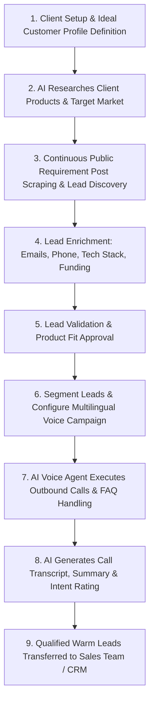

# 🚀 AI Sales Intelligence & Voice Agent Platform

An enterprise-grade, AI-powered sales automation platform that enables businesses to discover high-intent prospects across public channels (LinkedIn, X, company websites, public directories), enrich lead details, qualify intent, and execute automated **multilingual AI Voice outreach**—all within a single unified platform.

---

## 📌 Table of Contents
- [Overview](#-overview)
- [Key Features](#-key-features)
- [Core Modules](#-core-modules)
- [System Workflow](#-system-workflow)
- [Tech Stack](#-tech-stack)
- [Getting Started](#-getting-started)
- [Project Structure](#-project-structure)
- [License & Credits](#-license--credits)

---

## 💡 Overview

Traditional B2B lead generation tools rely on static contact databases that result in low-converting cold outreach. The **AI Sales Intelligence & Voice Agent Platform** solves this by actively discovering public buyer requirement posts, extracting intent signals, enriching decision-maker contact details, and deploying conversational AI Voice Agents to qualify prospects and schedule meetings.

### 🌟 Unique Selling Proposition (USP)
Unlike traditional lead platforms, this platform delivers an **end-to-end autonomous sales pipeline**—moving seamlessly from real-time buyer intent detection to automated interactive multilingual voice qualification and CRM hand-off.

---

## 🔑 Key Features

- 🔍 **Intent-Driven AI Lead Discovery**: Automatically scrapes and extracts public requirement posts from LinkedIn, X, company websites, and public directories.
- ⚡ **Automated Lead Enrichment**: Fetches verified business emails, direct phone numbers, LinkedIn profiles, job titles, company size, tech stack, and funding insights.
- 🎙️ **Multilingual AI Voice Agent**: Executes inbound & outbound voice calls, handles FAQs, leaves voicemails, automatically retries unanswered calls, and records transcripts with sentiment summaries.
- 📅 **Smart Campaign Scheduling**: Automates outbound outreach tailored to target prospect time zones and geographic regions.
- 📊 **Real-time Analytics & CRM**: Full pipeline tracking, conversation insights, CRM integration (Salesforce, HubSpot, Zoho), and interactive analytics dashboard.
- 🔐 **Enterprise Admin & RBAC**: Advanced user role management, voice minute usage tracking, subscription tiers, and audit security logging.

---

## 🛠️ Core Modules

| Module | Features & Capabilities |
| :--- | :--- |
| **Dashboard** | Real-time overview of active campaigns, leads discovered, call conversion metrics, and system activity. |
| **AI Lead Discovery** | Real-time tracking of requirement posts, platform sources, original post links, and intent scoring. |
| **Market Intelligence** | Company funding stages, hiring activity, tech stack breakdown, and competitor benchmarking. |
| **Lead Management** | Data validation, duplicate detection, CSV/Excel import/export, smart filters, and segmentation. |
| **AI Voice Agent** | Outbound/inbound call management, customizable AI voice personas, FAQ knowledge bases, and call recording/transcripts. |
| **Campaign Management** | Time-zone targeted campaign creation, retry logic configuration, and automated callback scheduling. |
| **Sales Pipeline & CRM** | Deal stages, lead scoring, CRM synchronization, and warm lead hand-off to human SDRs. |
| **Analytics & Reports** | Voice minute usage metrics, campaign ROI, conversion funnels, and call sentiment analytics. |
| **Admin Panel** | Multi-tenant organization settings, subscription plan controls, API usage, and security audit logs. |

---

## 🔄 System Workflow



---

## 💻 Tech Stack

- **Frontend Framework**: [React 18](https://react.dev/) + [TypeScript](https://www.typescriptlang.org/)
- **Build Tool**: [Vite 6](https://vitejs.dev/)
- **Styling & UI Components**:
  - [Tailwind CSS](https://tailwindcss.com/)
  - [Radix UI](https://www.radix-ui.com/) (Primitive UI Components)
  - [Lucide React](https://lucide.dev/) (Icons)
- **Data Visualization**: [Recharts](https://recharts.org/)
- **Routing & State**: [React Router v6](https://reactrouter.com/), React Context API

---

## 🚦 Getting Started

### Prerequisites
- **Node.js**: v18.x or higher
- **npm**: v9.x or higher

### Installation

1. **Clone the repository:**
   ```bash
   git clone https://github.com/your-org/ai-sales-intelligence-platform.git
   cd ai-sales-intelligence-platform
   ```

2. **Install dependencies:**
   ```bash
   npm install
   ```

3. **Start the development server:**
   ```bash
   npm run dev
   ```
   Open your browser and navigate to `http://localhost:5173`.

4. **Build for production:**
   ```bash
   npm run build
   ```

5. **Preview production build:**
   ```bash
   npm run preview
   ```

---

## 📂 Project Structure

```text
ai-sales-intelligence-platform/
├── public/                     # Static assets
├── src/
│   ├── components/             # Reusable UI components & layouts
│   ├── contexts/               # React Context Providers (Campaign, Lead, Auth states)
│   ├── data/                   # Mock datasets & initial platform data
│   ├── lib/                    # Helper utilities (clsx, tailwind-merge)
│   ├── pages/                  # Application views & dashboards
│   │   ├── AIQualification.tsx # AI lead scoring & intent qualification
│   │   ├── AIVoiceAgent.tsx    # Voice persona & calling configuration
│   │   ├── Admin.tsx           # Admin, subscriptions & security logs
│   │   ├── Analytics.tsx       # Conversion graphs & call statistics
│   │   ├── CRM.tsx             # CRM sync & integration setup
│   │   ├── CallHistory.tsx     # Audio recordings, transcripts & summaries
│   │   ├── Campaigns.tsx       # Campaign manager & time-zone scheduling
│   │   ├── Dashboard.tsx       # Main executive overview dashboard
│   │   ├── LeadDiscovery.tsx   # Real-time requirement post discovery
│   │   ├── Leads.tsx           # Lead lists, segmentation & import/export
│   │   ├── MarketIntelligence.tsx # Funding, tech stack & hiring insights
│   │   ├── SalesPipeline.tsx   # Visual Kanban pipeline & deal stages
│   │   └── Settings.tsx        # User profile & organization preferences
│   ├── services/               # API service interfaces
│   ├── App.tsx                 # Main Application Router & Navigation
│   ├── index.css               # Global Tailwind CSS styles
│   └── main.tsx                # React root entry point
├── AI Sales Agent Platform.pdf # Official Platform Specification Document
├── package.json                # Node dependencies & build scripts
├── tailwind.config.js          # Tailwind CSS styling configuration
├── vite.config.ts              # Vite configuration
└── README.md                   # Project documentation
```

---


