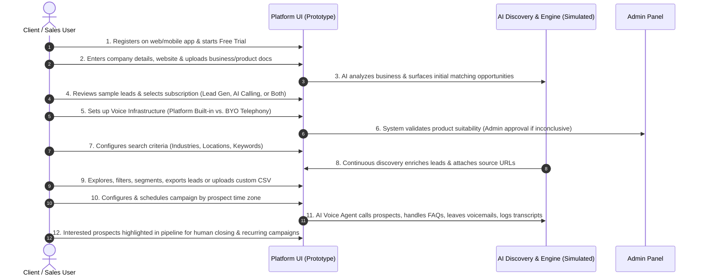

# 📋 AI Sales Intelligence & Voice Agent Platform
## Product Requirements Document (PRD) & Prototype Specification

> **Document Version:** 2.0 (Prototype & MVP Phase)  
> **Source Document:** `AI Sales Agent Platform.pdf` (Futurrizon Technologies Pvt. Ltd.)  
> **Target Scope:** **Prototype & Front-End Architecture** (Simulated / Mocked AI Services; Live AI Engine integrations deferred to Phase 2)  
> **Last Updated:** September 20, 2026  

---

## 📌 Table of Contents
1. [Executive Summary & Core Value Proposition (USP)](#1-executive-summary--core-value-proposition-usp)
2. [Platform & Business Model Specification](#2-platform--business-model-specification)
3. [Prototype Scope vs. Live AI Integration Scope](#3-prototype-scope-vs-live-ai-integration-scope)
4. [Data Model & Discovered Lead Schema](#4-data-model--discovered-lead-schema)
5. [End-to-End 12-Step User Journey (PDF Alignment)](#5-end-to-end-12-step-user-journey-pdf-alignment)
6. [Core Functional Modules Specification](#6-core-functional-modules-specification)
7. [Admin & Enterprise Governance Specification](#7-admin--enterprise-governance-specification)
8. [Non-Functional & Architectural Requirements](#8-non-functional--architectural-requirements)
9. [Important Compliance & Transparency Rules](#9-important-compliance--transparency-rules)
10. [Expected Business & Operational Outcomes](#10-expected-business--operational-outcomes)
11. [Sample Reference Post & Intent Discovery Scenario](#11-sample-reference-post--intent-discovery-scenario)
12. [Proposed Differentiators & Innovative USPs](#12-proposed-differentiators--innovative-usps)
13. [Codebase Gap Analysis & Prototype Verification Checklist](#13-codebase-gap-analysis--prototype-verification-checklist)

---

## 1. Executive Summary & Core Value Proposition (USP)

### 1.1 Overview
The **AI Sales Intelligence & Voice Agent Platform** is an enterprise-grade sales automation system that discovers, enriches, qualifies, and engages high-intent B2B prospects across multiple public sources. Rather than relying on outdated static contact databases, businesses use this unified platform to actively identify real buyer requirement postings, enrich decision-maker information, automate multilingual voice outreach, and convert leads through structured sales pipelines.

The platform combines six foundational pillars into a single enterprise solution:
- **AI Lead Discovery**
- **Lead Enrichment**
- **Market Intelligence**
- **Lead Management**
- **AI Voice Automation**
- **CRM Integration & Sales Analytics**

### 1.2 Unique Selling Proposition (USP)
> **Unlike traditional lead generation tools that provide static, unverified email lists, this platform delivers an end-to-end autonomous sales workflow:**
> 1. Real-time scraping & NLP detection of **active public requirement posts** across LinkedIn, X, company websites, public directories, and freelance platforms.
> 2. Automated multi-source contact enrichment and market intelligence.
> 3. AI intent qualification, BANT scoring, and buying-signal extraction.
> 4. Autonomous conversational **multilingual AI Voice outreach** with real-time FAQ handling, voicemail drops, callback scheduling, and transcript generation.
> 5. Seamless hand-off of warm, qualified opportunities into CRM and human SDR queues.

---

## 2. Platform & Business Model Specification

### 2.1 Multi-Platform Access
- **Web Application**: Responsive desktop and tablet dashboard (Primary Prototype Focus).
- **Mobile Application**: Android & iOS companion apps for sales representatives on the go.

### 2.2 Subscription Tiers
| Tier | Monthly / Annual Base | Discovered Contacts / mo | Voice Outreach Minutes | Target Segment |
| :--- | :--- | :--- | :--- | :--- |
| **Starter** | $99 / mo | 500 verified leads | 500 voice minutes | Early-stage startups & solo consultants |
| **Growth** | $299 / mo | 5,000 verified leads | 2,000 voice minutes | Scaling B2B sales teams |
| **Enterprise** | $899 / mo | 50,000+ verified leads | 10,000+ voice minutes | Large sales organizations with custom BYO telephony |

### 2.3 Pricing Model
- **Hybrid Subscription + Usage-based Billing**:
  - Base monthly subscription tier fee.
  - Overage metering for:
    1. AI Voice Minutes consumed (inbound + outbound).
    2. Additional enriched contacts beyond monthly quota.
    3. Dedicated API integrations and webhook consumption.

---

## 3. Prototype Scope vs. Live AI Integration Scope

> **Important Directive**: Current verification and development focuses strictly on the **Interactive Prototype**. Live third-party AI APIs (OpenAI, Anthropic, Gemini), real-time headless web scrapers, live telecom carrier gateways (Twilio/SIP trunking), and live cloud infrastructure are **not required** for prototype sign-off.

| Capability Area | 🧪 Prototype Scope (Current Target) | 🚀 Phase 2: Live AI Integration |
| :--- | :--- | :--- |
| **AI Lead Discovery** | Deterministic / simulated query runner with multi-source filtering (LinkedIn, X, Websites, Directories), multi-step progress indicators, and rich mock lead datasets. | Distributed web scrapers, proxy rotators, LinkedIn/X API integrations, live HTML parser. |
| **Intent Scoring & NLP** | Computed heuristic scoring algorithm, visual breakdown (Need clarity, Urgency, Budget, Authority), and editable AI reasoning cards. | Large Language Model (LLM) fine-tuned prompt chains, embeddings, and sentiment classifiers. |
| **Market Intelligence** | Structured mock database displaying funding rounds, hiring trends, tech stacks, and competitor matrices. | Real-time integrations with Crunchbase, GitHub, BuiltWith, Owler, and LinkedIn Talent Insights. |
| **AI Voice Agent** | Interactive call monitor with simulated active calls, live status indicators, pre-generated audio simulations, conversational transcript viewer, and sentiment badges. | WebRTC / SIP live voice stream, Twilio/Vonage carrier trunking, Real-time Speech-to-Text (STT) + Text-to-Speech (TTS) low-latency pipeline. |
| **Campaign Scheduling** | Full UI wizard for time-zone targeting, pacing, voicemail templates, retry rules, and callback triggers with stateful scheduling in local storage / context. | Celery / Temporal distributed cron workers, carrier rate limiters, global time zone dispatchers. |
| **Multilingual Support** | Top-bar language switcher (English, Hindi, Gujarati, etc.) toggling navigation, labels, and localized preview mock data. | Multilingual LLM voice agents with real-time accent adaptation and polyglot ASR. |
| **CRM & Exports** | Client-side CSV/Excel export generator, simulated CRM sync toggles (Salesforce, HubSpot, Zoho), and status badges. | Live OAuth 2.0 two-way sync, webhook listener, and bidirectional CRM custom field mapping. |
| **Admin & Security** | Comprehensive administrative views for tenant management, voice minutes usage graphs, subscription upgrades, audit logs, and fraud alerts. | Multi-tenant PostgreSQL with row-level security (RLS), Stripe billing webhooks, enterprise SAML/SSO. |

---

## 4. Data Model & Discovered Lead Schema

Every lead discovered and managed on the platform captures the complete schema specified in the PDF:

```typescript
export interface Lead {
  // Identification & Core Contact (PDF Page 1)
  id: string
  name: string                          // Decision maker / post author name
  jobTitle: string                      // e.g. "Head of Technology", "VP of Sales"
  email: string                         // Verified business email (if available)
  phone: string                         // Direct dial or phone number (if available)
  linkedin: string                      // LinkedIn profile URL
  website: string                       // Company official website
  
  // Organization Details (PDF Page 1)
  company: string                       // Company name
  industry: string                      // Industry category (IT, FinTech, SaaS, Healthcare, etc.)
  location: string                      // City, Region
  country: string                       // Country for time-zone outreach
  companySize: string                   // Employee tier (1-10, 11-50, 51-200, etc.)
  employees: number                     // Exact headcount estimate

  // Public Requirement & Sourcing (MANDATORY PDF TRANSPARENCY REQUIREMENT)
  requirement: string                   // Full extracted text of the requirement post
  source: 'LinkedIn' | 'X' | 'Company Website' | 'Public Directory' | 'Freelance Platform' | 'CRM'
  sourceUrl: string                     // Direct hyperlink to the original public post
  discoveredAt: Date                    // Date & time post was detected

  // AI Qualification & Intelligence (PDF Page 1 & 2)
  intentScore: number                   // Overall intent score (0 - 100)
  intent: 'HIGH' | 'MEDIUM' | 'LOW'     // Intent tier
  needClarity: number                   // Clarity of requirement (0 - 100)
  urgency: number                       // Timeline urgency score (0 - 100)
  budgetScore: number                   // Budget allocation indicator (0 - 100)
  authorityScore: number                // Decision-making power score (0 - 100)
  budgetSignal: 'HIGH' | 'MEDIUM' | 'LOW' | 'UNKNOWN'
  timeline: string                      // e.g. "Immediate (Q4)", "Within 30 days"
  decisionMaker: boolean                // Whether contact holds buying authority
  aiReasoning: string                   // AI generated breakdown of why lead is relevant
  aiRecommendations: string[]           // Recommended talking points for call

  // Market Intelligence Signals (PDF Page 1)
  funding: string                       // Recent funding stage (Seed, Series A, Bootstrapped)
  hiringStatus: string                  // Hiring velocity (e.g. "Aggressive Hiring")
  techStack: string[]                   // Current company tech stack
  competitors: string[]                 // Identified competitors

  // Sales Pipeline & Campaign State (PDF Page 2 & 4)
  status: 'NEW' | 'ENRICHED' | 'QUALIFIED' | 'CONTACTED' | 'INTERESTED' | 'MEETING' | 'OPPORTUNITY' | 'WON' | 'LOST' | 'NOT_QUALIFIED'
  campaignId: string | null             // Linked campaign ID
  lastActivity: Date                    // Timestamp of last interaction
  nextAction: string                    // Recommended next sales step
  tags: string[]                        // Custom segmentation tags
}
```

---

## 5. End-to-End 12-Step User Journey (PDF Alignment)

The platform satisfies and demonstrates all 12 steps defined in the official specification document:



### Detailed Step-by-Step Prototype Requirements:

#### Step 1: Registration & Free Trial
- Simple self-service registration modal/screen.
- Free trial account provisioning with pre-allocated credits (e.g., 50 discovery leads, 30 voice minutes).

#### Step 2: Company Profile & Business Knowledge Setup
- Company website, business description, industry classification, and target market definition.
- **Business Documents & Product Catalog Upload**: UI allowing the user to upload PDF/DOCX sales materials, pricing sheets, and FAQ documents to train the AI Voice Agent persona.

#### Step 3: AI Business Research & Opportunity Matching
- Interactive "Opportunity Discovery Preview" screen showing real-time scanning simulation.
- Demonstration of buyer requirements discovered matching the client's products.

#### Step 4: Subscription Plan Selection
- Modular subscription options allowing the client to choose:
  - **Lead Generation Only**
  - **AI Voice Calling Only**
  - **Unified Suite (Lead Gen + AI Calling)**
- Tier selector (Starter, Growth, Enterprise) with transparent feature breakdown.

#### Step 5: Calling Infrastructure Setup
- Choice between:
  - **Platform Built-in Calling**: Instant setup, out-of-the-box carrier numbers, metered voice minutes.
  - **Bring Your Own (BYO) Telephony**: Custom SIP trunk, Twilio, or Plivo credentials with phone number assignment.
- Voice persona configuration: Voice selection (Aria, Marcus, etc.), pitch, speed, and language accent.

#### Step 6: Product/Service AI Selling Suitability Validation
- Automated risk & suitability evaluation algorithm (checking if products are legally compliant and viable for autonomous voice qualification).
- **Admin Approval Queue**: If suitability is flagged as inconclusive, submission is routed to `Admin -> Product Approvals` for human administrator sign-off.

#### Step 7: Prospect Targeting Configuration
- Multi-dimensional query builder:
  - Industry selection (IT Services, FinTech, SaaS, Healthcare, etc.).
  - Geographic location / Country filters (India, USA, UK, UAE, Singapore, etc.).
  - Target company size (1-10, 11-50, 51-200, 201-500, etc.).
  - Intent keywords & requirement search.
  - Source platform toggles (LinkedIn, X, Company Websites, Public Directories, Freelance).

#### Step 8: Continuous Discovery & Enrichment Engine
- Automated background simulation that adds newly detected buyer postings.
- Automatic enrichment with decision-maker contact details (Name, Job Title, Business Email, Phone, LinkedIn).
- **Guaranteed Transparency**: Every lead displays the **Original Requirement Post URL** and source platform icon.

#### Step 9: Lead Exploration, Filtering, Export & Custom Upload
- Fast, searchable data table with sorting, bulk selection, and column filtering.
- **Export Capabilities**: 1-click export to **CSV** and **Excel (.xlsx)** format.
- **Custom Lead List Upload**: Drag-and-drop CSV/Excel import with field mapping, data validation, and duplicate detection.

#### Step 10: Campaign Creation & Time-Zone Scheduling
- Multi-step campaign builder:
  - Campaign naming and lead segment attachment.
  - Calling schedule window (e.g. 09:00 AM - 06:00 PM in prospect's local time zone).
  - Launch mode: Immediate trigger or scheduled recurrence (Daily, Weekly, Monthly).
  - Automated retry configuration: Retry unanswered calls up to $N$ times with custom delays.

#### Step 11: Multilingual AI Voice Outreach Execution
- Live Call Monitor dashboard displaying active calls with duration, current qualification stage, and sentiment.
- AI conversation simulator featuring:
  - Full conversational transcript viewer (AI vs. Prospect turns).
  - Sentiment analysis (Positive, Neutral, Skeptical, Negative).
  - Voicemail drop handling when call reaches answering machine.
  - Automated callback scheduling when prospect requests to be contacted later (retried until answered).
  - Real-time summary and recommended **Next-Best Action**.
  - Immediate hand-off to client once prospect responds / shows interest.

#### Step 12: Pipeline Prioritization & Campaign Recurrence
- High-intent and qualified prospects automatically highlighted in the **Sales Pipeline (Kanban)**.
- Hot leads moved to "INTERESTED" or "MEETING BOOKED" stages with 1-click CRM push.
- Campaign analytics overview with ROI metrics, conversion funnels, and repeat campaign controls (daily, weekly, monthly).

---

## 6. Core Functional Modules Specification

### 6.1 AI Lead Discovery Module
- **Search & Filters**: Industry, Country, Company Size, Keyword, Source Platform.
- **Results Table**: Lead Name, Company, Requirement excerpt, Intent Score, Source badge, Date discovered, Actions.
- **Lead Detail Drawer/Modal**:
  - Full verbatim text of buyer requirement post.
  - Clickable link to original posting URL.
  - Enriched contact details (Email, Phone, LinkedIn profile).
  - Intent breakdown chart (Need Clarity, Urgency, Budget, Authority).
  - AI reasoning explanation.
  - 1-click "Add to Campaign" or "Add to Pipeline".

### 6.2 Lead Enrichment & Market Intelligence Module
- **Company Profile Card**: Founded date, headquarters, employee count, website link.
- **Market Signals**:
  - Funding rounds (Amount, lead investors, date).
  - Hiring trends (Open engineering, sales, leadership roles).
  - Detected technology stack (CRM, cloud providers, frontend/backend tools).
  - Competitor benchmark comparison.

### 6.3 Lead Management Module
- Tabular lead database with multi-select bulk operations.
- Status filters: `NEW`, `ENRICHED`, `QUALIFIED`, `CONTACTED`, `INTERESTED`, `MEETING`, `OPPORTUNITY`, `WON`, `LOST`.
- **Import Modal**: CSV/Excel file parser with automatic header mapping and duplicate detection counter.
- **Export Generator**: Clean download of filtered records in CSV/Excel format.

### 6.4 AI Voice Agent & Call Management Module
- **Live Monitor**: Visual grid of active calls with real-time timers and stage progression.
- **Call History & Recording Logs**:
  - Filterable call records with outcome badges (`ANSWERED`, `BUSY`, `VOICEMAIL`, `NO_ANSWER`).
  - Audio playback simulator with play/pause, scrub bar, and speed controls.
  - Synchronized transcript view with speaker labels and timestamps.
  - Key buying signals and objection tags.
  - Direct dial / manual callback trigger for human sales agents.

### 6.5 Campaign Management Module
- Campaign list with status (`RUNNING`, `PAUSED`, `SCHEDULED`, `COMPLETED`).
- Metrics per campaign: Total leads, calls placed, answer rate, qualification rate, meetings booked.
- Pacing and retry rules (unanswered retry limits, voicemail behavior).
- Recurring schedule configuration (daily, weekly, monthly).

### 6.6 Sales Pipeline & CRM Integration
- Visual Kanban board with stages:
  1. `Qualified Lead`
  2. `Contacted / In Progress`
  3. `Interested (High Priority)`
  4. `Meeting Scheduled`
  5. `Proposal / Opportunity`
  6. `Closed Won` / `Closed Lost`
- Drag-and-drop or 1-click stage advancement.
- CRM Sync panel for Salesforce, HubSpot, and Zoho CRM with last sync timestamps and field mapping status.

---

## 7. Admin & Enterprise Governance Specification

The administrative console provides centralized platform control across 9 specialized views:

| Admin Sub-module | Functional Prototype Requirements |
| :--- | :--- |
| **Admin Dashboard** | High-level metrics (Total Users, Active Subscribers, Monthly Revenue, Total Voice Minutes Consumed), 30-day activity trend charts, and recent fraud alerts. |
| **User Management** | Complete tenant list with plan badges, role assignments (`Admin`, `Sales Manager`, `SDR`), voice usage meters, status (`ACTIVE`, `TRIAL`, `SUSPENDED`), and 1-click user suspend/reactivate toggles. |
| **Product AI Approvals** | **(Journey Step 6)** Review queue for client product catalogs flagged as inconclusive for AI selling. Approve / Reject with reviewer notes. |
| **Subscriptions & Plans** | Plan tier management (`Starter`, `Growth`, `Enterprise`), subscriber counts, MRR/ARR counters, and tier feature limit configuration. |
| **Voice Usage & Billing** | Voice minute consumption graphs by organization, overage alert thresholds, and downloadable invoice history with PDF export simulation. |
| **Audit Logs** | Immutable security logs with timestamps, actor email, action category, IP address, and severity badges (`INFO`, `WARNING`, `CRITICAL`). |
| **Fraud Detection** | AI-driven fraud anomaly detection (e.g. rate limit abuse, suspicious VoIP call spikes, disposable email signups, credential stuffing) with action triggers. |
| **System Health & Monitoring** | Real-time service status indicators (API Gateway, AI Inference, Voice Telephony, Database, CRM Webhooks) with latency metrics. |
| **Platform Settings** | Global AI discovery thresholds, default voice speeds, session timeout configurations, and IP allowlist policies. |

---

## 8. Non-Functional & Architectural Requirements

### 8.1 Performance & Responsiveness
- Instant UI interactions (< 100ms response on navigation and tab switching).
- High-efficiency client-side filtering and sorting for up to 10,000 lead records.
- Responsive design adapting seamlessly to desktop monitors (1920x1080), laptops (1366x768), and tablet/mobile viewports.

### 8.2 Security & Role-Based Access Control (RBAC)
- Role separation: `Super Admin`, `Admin`, `Sales Manager`, `Sales Rep / SDR`.
- Simulated session security with 2FA toggle and audit trail logging.

### 8.3 Multilingual Architecture
- **Application Interface**: Internationalization (i18n) framework supporting major languages (English, Hindi, Gujarati, with extensible locale architecture).
- **Voice Agent Multilingual Persona**: UI configuration for multilingual outbound conversations and language-specific conversational scripts.

---

## 9. Important Compliance & Transparency Rules

The PDF document explicitly mandates five fundamental operating constraints:

1. **Mandatory Multilingual Support**: The application UI and voice interactions must be accessible in major languages for an inclusive global sales experience.
2. **Publicly Sourced Leads Only**: Leads must strictly be sourced from public domain postings or verified authorized platform integrations.
3. **Public Availability of Contact Data**: Email and phone details are surfaced only when publicly available.
4. **Source Fallback Mechanism**: Whenever phone or email data is unavailable, the platform must provide a direct fallback pathway to connect with the prospect via the original source platform post.
5. **Absolute Transparency Guarantee**: Every single lead card and table row **MUST ALWAYS display the Original Requirement Post URL** and the Source Platform icon.

---

## 10. Expected Business & Operational Outcomes

Aligned with PDF Page 4, the platform delivers 7 measurable outcomes:
1. **Discover High-Intent Prospects from Multiple Public Sources**: Continuous aggregation from LinkedIn, X, company sites, directories, and freelancing platforms.
2. **AI-Powered Lead Enrichment, Scoring, and Qualification**: Automated calculation of intent scores (0-100) and BANT criteria.
3. **Automated Multilingual Voice Outreach**: Direct conversational voice qualification with zero human latency.
4. **Reduced Manual Prospecting, Qualification, and Sales Efforts**: Up to 80% time savings for sales teams.
5. **Higher Sales Productivity, Conversion Rates, and Pipeline Visibility**: Instant visual tracking in Kanban sales pipelines.
6. **Increased Meetings, Customer Engagement, and Revenue Opportunities**: High-priority routing of prospects who requested demos or callbacks.
7. **Real-Time Market Intelligence for Better Sales Targeting and Decision-Making**: Deep visibility into competitors, funding rounds, and hiring shifts.

---

## 11. Sample Reference Post & Intent Discovery Scenario

As highlighted in the reference document (PDF Page 2), the system processes unstructured public posts like the following:

> **Example LinkedIn Post:**
> *"Looking for a SharePoint Implementation Partner! We're currently seeking a reliable and experienced SharePoint implementation partner to support an upcoming project focused on enhancing collaboration, document management, and workflow automation.*
> *Key Areas of Interest: SharePoint Online setup, custom app development, Microsoft 365 integration, legacy migration, user training.*
> *DMs open | Referrals welcome | Let's connect!"*

**How Platform Processes this in Prototype:**
- **Source Extracted**: `LinkedIn` with verified post URL.
- **Intent Level Computed**: `HIGH` (Intent Score: 95/100).
- **Need Clarity**: 92/100, **Budget Signal**: High, **Urgency**: Immediate kick-off.
- **Enriched Profile**: Author name, company website, verified email, direct phone number, tech stack (SharePoint, M365, Azure).
- **Voice Campaign Trigger**: AI Voice Agent conducts outbound discovery call, asks about existing tenant setup, validates budget, and books discovery meeting.

---

## 12. Proposed Differentiators & Innovative USPs

*(Encouraged by document guidelines: "Teams are encouraged to identify and propose additional Unique Selling Propositions (USPs), innovative capabilities, AI differentiators, or business value propositions beyond the features mentioned here to make their solution more innovative, competitive, & valuable.")*

1. **Omni-Channel Voice + WhatsApp / SMS Fallback**: If a prospect does not answer the AI call after 2 retries, automatically trigger an interactive WhatsApp message linking to a self-serve meeting calendar.
2. **Dynamic Objection-Handling Playbooks**: Real-time AI agent script branching based on competitor mentions (e.g. if prospect mentions "We already use Competitor X", agent highlights key architectural advantages).
3. **Real-Time Buyer Intent Pulse (BIP)**: Heatmap showing companies with surging hiring activity + public RFPs in specific technology sectors.
4. **Autonomous Voice Callback Scheduler**: Prospect can say *"I am driving, call me tomorrow at 3 PM"* and the AI agent automatically extracts the timestamp, schedules the callback, and dispatches the outbound call at the exact scheduled minute.

---

## 13. Codebase Gap Analysis & Prototype Verification Checklist

### 13.1 Feature Implementation Status

| Requirement from PDF | Codebase File Location | Prototype Status | Notes / Next Action |
| :--- | :--- | :--- | :--- |
| **AI Lead Discovery (Sources & Filters)** | `src/pages/LeadDiscovery.tsx` |  **Complete** | Supports LinkedIn, X, Websites, Directories, CRM, Freelance filters with step-by-step progress simulation. |
| **Original Post URL & Transparency** | `src/pages/LeadDiscovery.tsx`, `src/data/leads.ts` |  **Complete** | `sourceUrl` and `source` explicitly displayed with external link triggers. |
| **Lead Enrichment & Market Intel** | `src/pages/MarketIntelligence.tsx`, `src/pages/AIQualification.tsx` |  **Complete** | Displays tech stack, funding rounds, hiring signals, and intent breakdowns. |
| **Lead Management & Import/Export** | `src/pages/Leads.tsx`, `src/lib/exportCsv.ts` |  **Complete** | CSV export implemented; custom CSV drag-and-drop import modal active. |
| **AI Voice Agent Monitor & Transcripts** | `src/pages/AIVoiceAgent.tsx`, `src/pages/CallHistory.tsx` |  **Complete** | Live active call monitor, audio waveform simulator, transcripts, and next-best actions. |
| **Campaign Time-Zone Scheduling** | `src/pages/Campaigns.tsx` |  **Complete** | Multi-time-zone campaign scheduler with retry rules and pacing controls. |
| **Sales Pipeline & Warm Lead Hand-off** | `src/pages/SalesPipeline.tsx` |  **Complete** | Kanban pipeline with CRM push simulation and deal stage updates. |
| **CRM Integration (Salesforce, HubSpot, Zoho)** | `src/pages/CRM.tsx` |  **Complete** | Integration toggle cards, sync interval settings, and status monitoring. |
| **Enterprise Admin Dashboard & Audit Logs** | `src/pages/Admin.tsx` |  **Complete** | 9 admin tabs including audit logs, fraud detection, voice usage, and billing invoices. |
| **Multilingual UI Switcher** | `src/components/layout/TopBar.tsx`, `src/lib/i18n.ts` |  **Complete** | Global switcher supporting English, Hindi, Gujarati. |
| **Business Document & Catalog Upload (Journey Step 2)** | `src/pages/Settings.tsx` |  **Complete** | Dedicated Business Knowledge & Docs tab with file drag-and-drop, catalog indexing, entity extraction highlights, and grounding status. |
| **Calling Infrastructure Selector (Journey Step 5)** | `src/pages/Settings.tsx`, `src/pages/AIVoiceAgent.tsx` |  **Complete** | Explicit selector for "Platform Built-in Calling" vs. "BYO Telephony (SIP/Twilio/Plivo)" with credentials, caller ID, and carrier latency test. |
| **Product AI Suitability Validation & Admin Queue (Journey Step 6)** | `src/pages/Admin.tsx`, `src/components/layout/Sidebar.tsx` |  **Complete** | Dedicated "Product Approvals" admin route (`/admin/product-approvals`) with risk scoring, catalog preview, and Approve/Reject governance actions. |
| **Subscription Plan Choice (Journey Step 4)** | `src/pages/Settings.tsx` (Billing tab) |  **Complete** | Modular service switcher (Lead Generation Only $149, AI Voice Calling Only $199, Unified Suite $299) + tier selector (Starter, Growth, Enterprise). |

---

### 13.2 Prototype Verification Sign-Off Criteria

To consider the prototype 100% complete and fully aligned with the requirements document:
- [x] All 5 Core Modules accessible and interactive via sidebar navigation.
- [x] Discovered lead schema contains all 11 mandatory fields from PDF Page 1.
- [x] Original requirement post URLs are directly clickable for every prospect.
- [x] AI Voice Agent simulator displays real-time stages, call transcript, and next-best action recommendations.
- [x] Multi-tenant Admin console monitors voice minutes, subscription revenue, audit logs, and fraud alerts.
- [x] Multilingual language switcher is functional in the top navigation bar.
- [x] Product suitability approval queue available in Admin console (`/admin/product-approvals`).
- [x] Business document upload and telephony provider toggle available in settings and agent configuration.
- [x] Modular subscription selection (Lead Gen vs Voice Calling vs Both) available in Billing.
